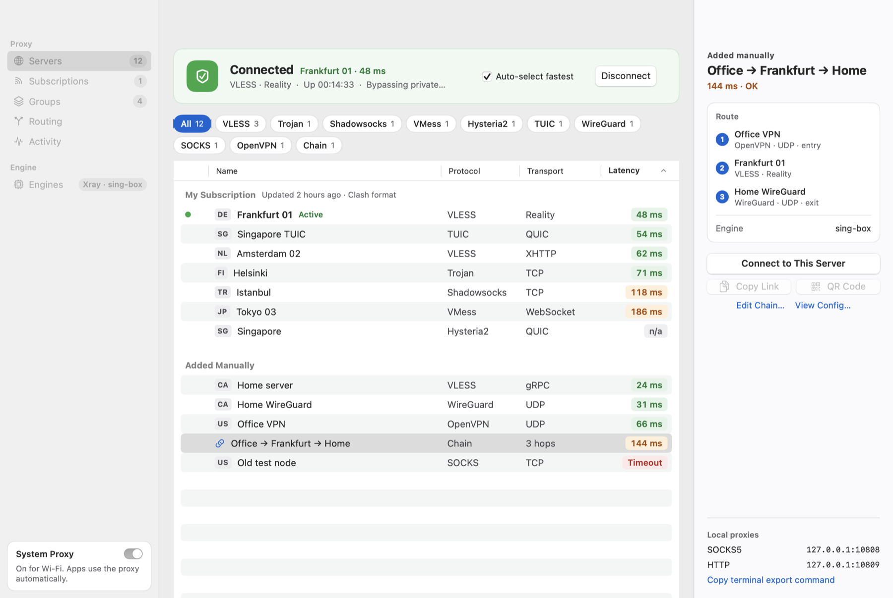

<div align="center">


# Keyway

**A native macOS client for Xray, V2Ray and sing-box, with proxy chaining.**

Import a link or subscription, chain servers together, and connect in one click.
Built in SwiftUI. No Electron, no web view, no config files.

[**Download for macOS**](https://github.com/arminsameti/keyway/releases/latest) · [Features](#features) · [FAQ](#faq) · [Build from source](#for-developers)

  


</div>

Keyway is a free, open-source, native macOS app for people who use **Xray-core (VLESS, VMess, Trojan, Reality)** or **sing-box (Hysteria2, TUIC, WireGuard, OpenVPN)**, optionally **V2Ray core** or **Tor**, and want a Mac client that feels like a Mac app. It downloads and manages the engines for you, picks the right one for every server, and lets you build **multi-hop proxy chains** across protocols. If you are looking for a V2RayX, V2rayU or v2rayN alternative on macOS, this is it.

## Download and use

1. Download `Keyway-<version>-macOS.dmg` from the [latest release](https://github.com/arminsameti/Keyway/releases/latest) (a `.zip` of the same app is there too).
2. Open the disk image and drag **Keyway** onto the **Applications** shortcut, then open it. It needs macOS 14 Sonoma or later, on Apple silicon or Intel (universal build, about 14 MB).
3. The builds are not notarized yet, so macOS may refuse the first launch. Right-click the app, choose **Open**, then confirm. If that still fails, run `xattr -dr com.apple.quarantine /Applications/Keyway.app` once.
4. Follow the three onboarding steps: download an engine, add servers, connect.

Check the download against `SHA256SUMS.txt` on the release page. Keyway lives in the menu bar, so you can connect, switch server and toggle the system proxy without opening the window. When a newer release exists, Settings › General › Updates and the menu bar say so; **Download** saves the disk image to your Downloads folder, checks it against the release's `SHA256SUMS.txt` and shows it in Finder. Keyway never replaces itself, so you install it the same way as the first time.

## Features

### Native and fast

- **A real Mac app:** SwiftUI interface, menu bar controls, light and dark mode, keyboard shortcuts, VoiceOver labels. It is not a web page in a wrapper.
- **Light on resources:** a small Swift app plus a Go backend. The universal download is about 14 MB.
- **Fast to use:** paste links from the clipboard, test latency of every server through its real engine, and let **auto-select fastest** pick the best one. It switches only when the current server is dead or clearly slower, so it never flaps between two similar servers.

<p align="center">

</p>

### Proxy chaining

Route traffic through several servers in a row, and mix protocols freely, for example **OpenVPN → VLESS Reality → WireGuard**. Each server only knows its neighbours.

- Chains can have any number of hops. One engine process runs the whole chain when it can; when hops need different engines, Keyway runs them as separate processes joined by a private loopback bridge and stops the chain if any part dies.
- The editor tells you exactly which hop breaks a chain and why (for example a UDP hop needs the hop before it to carry UDP).
- **Test Connection** checks every hop end to end before you save.

### Every protocol, both engines

| Engine | Protocols |
|---|---|
| **Xray-core** | VLESS (Reality, Vision, XHTTP), VMess, Trojan, Shadowsocks (incl. 2022), SOCKS5, HTTP, WireGuard, Hysteria2 |
| **sing-box** | Hysteria and Hysteria2, TUIC v5, AnyTLS, ShadowTLS, NaiveProxy, WireGuard, OpenVPN, plus VLESS, VMess, Trojan and Shadowsocks |
| **V2Ray core** (optional) | VLESS over TLS, VMess, Trojan, Shadowsocks, SOCKS5, HTTP |

Keyway downloads Xray and sing-box from their official GitHub releases, verifies their checksums, keeps them updated, and runs whichever engine supports each server. When both can, you choose the preference. Servers that need a specific engine (for example plain VLESS without TLS, which current Xray refuses) are moved to the right one automatically.

V2Ray core is optional. Download it in **Settings › Engines** and choose **Prefer V2Ray core** to run the servers it supports through v2ray-core itself. Keyway only uses it when every setting of a server takes effect there, so Reality, Vision, pinned certificates and servers with a TLS fingerprint stay on Xray or sing-box.

### Tor (optional)

Turn on **Settings › Engines › Enable Tor** to use the Tor network from Keyway. It is off by default, and while it is off nothing about Tor is shown, downloaded or run.

- **A Tor server is a normal entry in your list.** Connect to it directly, or put it anywhere in a chain: `Tor → VLESS`, `VLESS → Tor`, or `A → Tor → B`. A chain can have one Tor hop.
- **Bridges** for networks where Tor is blocked: obfs4, Snowflake, meek, or your own lines from bridges.torproject.org.
- **Limits:** Tor carries TCP only, so WireGuard, Hysteria and other UDP hops cannot come after it, and Snowflake cannot sit behind another hop. Tor needs sing-box installed too, which Keyway downloads for you; it serves your apps, the system proxy and routing rules. Auto-select never picks Tor.
- Tor is downloaded from the Tor Project (its Expert Bundle) and checked against the SHA-256 they publish.

### Import from anywhere

Share links (`vless://`, `vmess://`, `trojan://`, `ss://`, `hysteria2://`, `tuic://` and more), **subscription URLs**, a **QR code on your screen**, WireGuard `.conf`, OpenVPN `.ovpn`, **Clash YAML** and **sing-box JSON**. Subscriptions refresh automatically.

### Subscription details and groups

- **Usage and expiry.** When your provider sends the standard `Subscription-Userinfo`, `Profile-Title` and `Profile-Update-Interval` headers, Keyway shows traffic used, the quota, an "expires in N days" line and the provider's refresh interval next to the subscription. A provider's interval replaces your global one, but turning automatic refresh off still wins.
- **Groups** act as one server. Pick **Manual** (you choose the server), **Fallback** (the first server in the list that works) or **Fastest** (re-tested regularly, and it only switches when another server is clearly faster, so it does not flap). Select a group like any server, in the window or the menu bar. Make one by hand, or from a subscription's **Group** menu to cover all its servers.
- **Clash groups** (`proxy-groups`) of type select, url-test and fallback are imported as groups. load-balance, relay and unknown types are skipped, and the import says so. Entries that are not servers (DIRECT, REJECT, other groups) are left out and counted.
- A group can hold servers and chains, but a group cannot be a hop inside a chain. While a group is active, "choose fastest automatically" over all servers is paused.

### Routing and control

- **Routing modes:** global, bypass private and Chinese addresses, or your own **rule sets** (domains, `geosite`, `geoip`, IP ranges, ports, programs). Import rules from Clash or v2rayN and test which rule a destination hits.
- **Per-app rules:** proxy, bypass or block by application, for example `app:/Applications/Slack.app`.
- **TUN mode:** capture all traffic on the Mac, not only apps that respect the system proxy. See [TUN mode](#tun-mode-and-administrator-rights).
- **System proxy** is set on connect and restored on disconnect, quit or after a crash.
- **Per-server overrides:** multiplexing, SNI, uTLS fingerprint and TLS fragmentation.
- **Custom servers:** paste your own Xray or sing-box outbound JSON.
- **Live traffic:** upload and download speed and totals in the window and the menu bar.

### Private by design

Everything stays on your Mac in `~/.keyway` (owner-only permissions). Keyway sends nothing anywhere except the engine downloads, the subscription URLs you add, and a once-a-day request to GitHub for the newest Keyway release number. That update check carries nothing that identifies you or your Mac, and you can turn it off in Settings › General › Updates. The local API only listens on `127.0.0.1` and is protected by a per-launch token. Keyway is open source under the MIT license, so you can read exactly what it does.

### TUN mode and administrator rights

TUN starts sing-box as root. By default macOS asks for your password every time you connect. In Settings › Proxy you can instead choose **Allow Once…**, which installs a root-owned helper and a sudoers rule so later connects need no password. While that is installed, any program running as you can start a TUN session, and removing it deletes the rule. The helper refuses configs that touch files, listen on non-loopback addresses or use remote rule sets.

## FAQ

**What is Keyway?**
A free, open-source macOS client for Xray-core, sing-box and V2Ray core, with WireGuard, OpenVPN and Tor support. It gives you a native app for importing servers, chaining them and connecting, instead of editing JSON by hand.

**Is it a V2Ray / Xray client for Mac?**
Yes. It runs Xray-core (the successor to V2Ray) and imports V2Ray and Xray links, including VMess, VLESS, Trojan and Shadowsocks, plus subscriptions. You can also run v2fly's V2Ray core as an optional engine.

**Does it support proxy chaining or multi-hop?**
Yes. You can chain any number of servers and mix protocols, such as OpenVPN into VLESS Reality into WireGuard.

**Does it support Hysteria2, TUIC, WireGuard and OpenVPN?**
Yes, through sing-box, which Keyway installs and updates for you (WireGuard also runs on Xray-core). OpenVPN runs in userspace, so it needs no administrator rights.

**Does it support Tor?**
Yes, as an option. Turn it on in Settings › Engines, then use a Tor server on its own or as a hop in a chain, with bridges (obfs4, Snowflake, meek) for networks where Tor is blocked. See [Tor](#tor-optional).

**Does it work on Apple silicon and Intel Macs?**
Yes. The release is a universal build for macOS 14 or later.

**Does it include a system-wide VPN mode?**
Yes, TUN mode. It needs administrator approval, as described above.

**Why does macOS warn me when I open it?**
The builds are not notarized yet. Right-click the app and choose Open the first time, or remove the quarantine flag as shown in [Download and use](#download-and-use).

**Is it safe?**
The source is public. Engine downloads come only from the official GitHub releases and are verified before install, and the local API accepts only requests carrying a per-launch token. Keyway does not provide servers; you bring your own.

**Is Keyway a proxy or VPN service?**
No. It is a client. You add servers or subscriptions from a provider or your own server.

## Not included yet

A kill switch, Windows and Linux support, and signed or notarized builds.

## For developers

Keyway is a Go backend (`keywayd`) that exposes a local JSON API, plus a SwiftUI macOS app in `native/` that talks to it. The app bundles and starts the backend.

### Build

You need Go 1.22+ (use the latest Go for release builds; older toolchains produce binaries that current macOS refuses to start) and Xcode command line tools (Swift 5.10, macOS 14 SDK).

```sh
make build            # bin/keywayd and bin/keyway-tun-helper
make app              # universal dist/Keyway.app (SwiftUI, macOS 14+)
make run              # run the backend only: API on http://127.0.0.1:12345
make snapshots        # render every screen, light and dark, to dist/snapshots/
```

Backend flags: `-port`, `-data-dir`, `-version`. The API token is written to `~/.keyway/api-token` and sent as `X-Keyway-Token`.

### Checks

```sh
make vet && make lint
make smoke            # start the backend and call the API
make e2e              # real engines and connections through local fixture servers
make e2e-tor          # real Tor (needs the Tor network; slow, not a merge gate)
```

There are no unit tests; the end-to-end scripts are the tests. `make e2e` downloads sing-box and Xray through Keyway's own download code, runs sing-box as a fixture server on loopback, then connects through Shadowsocks (on both engines), plain VLESS and a two-hop chain. It fetches a local page through each and checks the server's log, so a request that bypasses the server fails. It also runs a real latency test and checks that disconnect leaves nothing running. `make e2e-tor` checks that the exit is Tor, loads an `.onion` page, runs a proxy-then-Tor chain and turns Tor off. Both use random ports and a temporary data directory, so they never touch a Keyway you have installed. `make lint` needs [golangci-lint](https://golangci-lint.run) v1.

CI (`.github/workflows/ci.yml`) runs on every push and pull request: gofmt, vet, golangci-lint and the smoke test; a full `make app` build of the macOS bundle with architecture and signature checks; and `make e2e`. `e2e-tor.yml` runs the Tor test on pushes to `master`, pull requests and nightly, without blocking merges.

### Release

Push a tag like `v0.2.0` (`git tag v0.2.0 && git push origin v0.2.0`). `.github/workflows/release.yml` builds the universal app on macOS, packages it as a DMG and a zip with a SHA-256 file, and publishes a GitHub release.

### Layout

| Package | Role |
|---|---|
| `cmd/keywayd` | wiring, signals, token and port files |
| `cmd/keyway-tun-helper` | root helper that validates a config and runs sing-box for TUN |
| `internal/models` | persisted data types (schema 3), validation |
| `internal/profile` | engine-neutral server description, overrides, custom servers |
| `internal/store` | atomic JSON persistence, backup, corruption quarantine |
| `internal/core` | list, download and verify engine releases, safe extraction |
| `internal/appupdate` | find the newest Keyway release and download its disk image, verified against `SHA256SUMS.txt` |
| `internal/link` | share links, WireGuard, OpenVPN, Clash and sing-box imports ⇄ profiles |
| `internal/engine` | `Engine` interface, capability-based selection, chain planner, process runner, latency probe |
| `internal/xray`, `internal/singbox`, `internal/tor` | config builders for each engine (`internal/tor` also reads Tor's bootstrap progress) |
| `internal/privileged` | helper validation, one-time install, elevated run |
| `internal/sysproxy` | macOS `networksetup` wrapper with crash recovery |
| `internal/service` | all business logic behind one lifecycle lock |
| `internal/api` | HTTP layer only: routing and security middleware |
| `native/` | SwiftPM package: `KeywayCore` (API client, models, forms) and the SwiftUI app |

### Security model

When Tor is enabled, its SOCKS port listens on loopback without a password (Tor cannot require one), so other programs on the same Mac can use it. It exposes only access through Tor and no secrets.

The API binds to 127.0.0.1 and defends against other local pages and processes: Host allow-list (DNS rebinding), Origin and `Sec-Fetch-Site` checks (CSRF), a per-launch token, JSON-only bodies capped at 1 MiB and a `default-src 'none'` CSP. Downloads come only from GitHub hosts (and `dist.torproject.org` for Tor) and are verified before install (Xray against its `.dgst`, sing-box against the SHA-256 GitHub reports, rule sets against the git blob hash). Only whitelisted archive entries are extracted. Subscription fetches are SSRF-guarded. Listeners on non-loopback addresses require credentials.

### Behaviour notes

- Connect runs the engine's config test on the new config before stopping the running instance.
- Each server runs on the engine that supports it; when several do, `settings.enginePreference` decides.
- **OpenVPN** runs on sing-box's userspace `openvpn-client`, with no admin rights. `.ovpn` files must embed their certificates and keys; TAP mode, static keys and passphrase-protected keys are refused with a reason.
- **Chains** (`protocol: "chain"`, `Node.chain` = hop IDs, entry first) run in one engine process when possible (sing-box `detour`, Xray `dialerProxy`). Hops needing different engines run as separate processes joined by a loopback SOCKS bridge with random per-connection credentials. A UDP hop needs the hop before it to carry UDP.
- **Traffic** comes from loopback-only counters (Xray stats API, sing-box Clash API with a random secret): `GET /api/traffic`.
- **Rule sets** (`routingMode: "rules"`): ordered rules `{entries, outbound}`, first match wins, default proxy. Entries: `domain:`, `full:`, `keyword:`, `regexp:`, `geosite:`, `geoip:`, CIDR, `port:`, `process:`, `process-path:`, `app:`. `POST /api/routing/import` reads Clash or v2rayN routing and `POST /api/routing/test` shows which rule a destination hits. Process and app entries need sing-box.
- **Per-app rules** use sing-box `find_process`. When a rule uses one and the server needs Xray, sing-box runs as a relay behind it. Without TUN only programs that use the proxy are seen.
- **Custom servers** (`protocol: "custom"`) use only the pasted outbounds; the app keeps its own inbounds, routing and DNS. `GET /api/nodes/{id}/config` shows the config that would run for any server.
- **Groups** (`AppData.groups`, `activeGroupId`): `activeNodeId` always mirrors the active group's current member, so connect logic only ever sees a node. The store reconciles groups on every update (pruned members, dropped groups of removed subscriptions). `url-test` reuses the auto-pick hysteresis and never picks Tor; the background loop re-tests only the active fallback/url-test group.
- A chain hop's address is dialed by the previous hop's server, so it must be reachable from there.
- "Real test" measures latency through a temporary instance of the server's engine; TCP mode marks UDP protocols as N/A.
- `POST /api/import/preview` classifies pasted text without saving or fetching anything.
- Auto-pick switches only when the current node is dead or at least 30% and 50 ms slower.
- Plain `http(s)://` links in the import box are treated as subscription URLs, not HTTP proxy nodes.

TUN and the helper were verified only up to the generated configs and a fake helper; starting a real TUN interface needs a password.

## Contributing

Issues and pull requests are welcome. Keyway is released under the [MIT License](LICENSE). Run `make vet` and `make smoke` before opening a PR.
